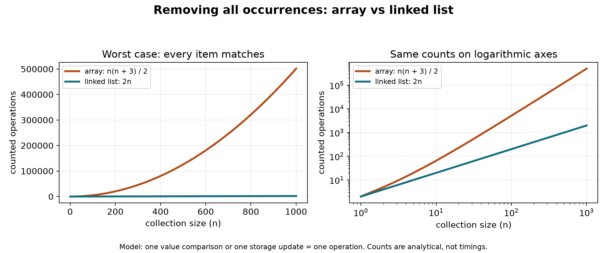

# Lab 6: algorithm efficiency analysis

## What the methods do

`ArrayManager.removeAllOccurances(Object o)` and `LinkedList.removeAllOccurances(Object o)` remove every matching item while preserving the order of the remaining items. The method spelling follows the lab handout.

For the required example:

```text
before: 1, 3, 4, 5, 3, 4, 3, 4, 1, 2, 5, 6
remove: 4
after:  1, 3, 5, 3, 3, 1, 2, 5, 6
```

ArrayManager stores integers, so a null or non-Integer target leaves it unchanged. LinkedList stores objects and uses Objects.equals, which also supports null targets. If the current list node is removed, the cursor moves to the next surviving node, or null if no later node survives. A cursor pointing to a surviving node stays there.

## Array algorithm

The array method scans from index zero. When it finds a match, it shifts every later item one position left and decreases count. It checks the same index again because a new value moved into that position. When there is no match, it advances the index.

This is a traversal and deletion algorithm. Removing an item near the beginning can require moving most of the array. Repeating that action for many matches makes the worst case quadratic, O(n^2).

For example, if every item is 4, the first removal shifts n - 1 items, the second shifts n - 2, and so on:

```text
(n - 1) + (n - 2) + ... + 1 + 0 = n(n - 1) / 2 shifts
```

## Linked-list algorithm

The linked-list method visits each node once, keeping a previous-node reference. It removes a match by changing the head or the previous node's next link. It never shifts later values or restarts traversal at the head. This makes its worst case linear, O(n).

If every node is 4, it visits and unlinks n nodes. The data structure lets each removal take constant work once the node has been reached.

## Approximate operation counts

For a concrete comparison, count one value comparison or one storage update as one operation. A storage update means writing an array slot or changing the list head/next link. Local-variable changes, loop conditions, count changes, and cursor updates are excluded from this simplified model. Including them changes constants, not the growth rates. Object equality is treated as constant time, as it is for the integer examples.

In the worst case, where every item matches:

- Array: n comparisons + n(n - 1)/2 shifts + n writes to clear the vacated slots = n(n + 3)/2 counted operations.
- Linked list: n comparisons + n link/head updates = 2n counted operations.

| Size n | Array operations | Linked-list operations |
| ---: | ---: | ---: |
| 10 | 65 | 20 |
| 100 | 5,150 | 200 |
| 1,000 | 501,500 | 2,000 |

For 12 matching values, the array performs 66 shifts, 12 comparisons, and 12 clearing writes: 90 counted operations. The linked list performs 12 comparisons and 12 head updates: 24 counted operations.

When no values match, both methods still inspect all n items and run in O(n) time. Both use O(1) additional space. The linked-list method has the better worst-case running time for these implementations. This comparison depends on the algorithm: an array method that compacts all survivors in one pass could also achieve O(n), but this implementation uses individual removals and shifts.

## Graph



The left panel uses ordinary axes. The right panel plots the same counts on logarithmic axes so both growth rates remain visible. These are calculated operation counts, not benchmark timings. The graph's data is in operation-counts.csv. Run plot_comparison.py with Python and matplotlib to regenerate it; Java does not need Python to run.

## Run and verify

In NetBeans, right-click `src/comp258/programs/AlgorithmEfficiencyDemo.java` and choose Run File. It prints both collections before and after removing 4. The existing main driver and menu options are unchanged.

The standalone tests are in `test/comp258/tests/RemovalTests.java`. They cover the required example, empty and single-item collections, consecutive matches, matching heads and tails, missing values, cursor updates, null/object targets, later inserts, and 250 deterministic randomized cases.

Validation: all 6,496 removal assertions and the 39 existing recursion checks passed with JDK 24. The project was also built using its NetBeans Ant script.
